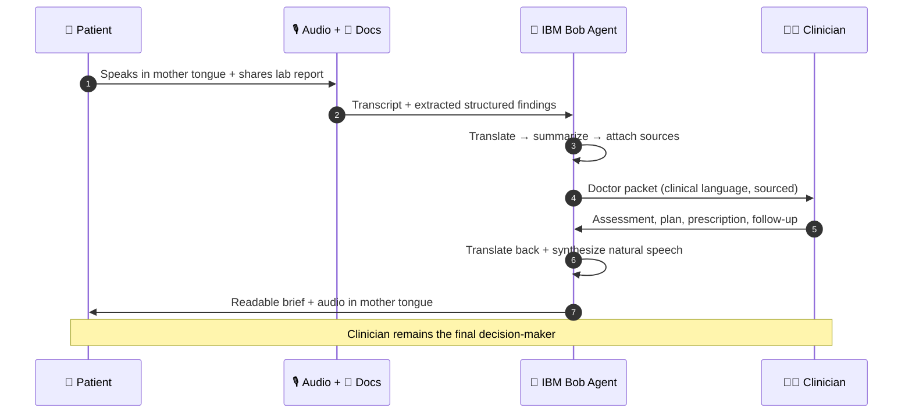

<div align="center">

# 🩺 The Healthy Bob

### A multilingual, voice-first healthcare bridge powered by **IBM Bob**

[](https://github.com/joshuapremkumar/the-healthy-bob)
[](https://www.python.org/)
[](https://www.ibm.com/)
[](#-quickstart)
[](#-the-loop)
[](LICENSE)
[](#-safety--disclaimer)

**Patient speaks → Bob structures → Doctor decides → Bob translates & speaks → Patient understands.**

</div>

---

## 🎯 What it does

The Healthy Bob is a hackathon-ready reference implementation of a **voice-first, multilingual clinical bridge**. It turns a patient's mother-tongue voice note and uploaded clinical documents into a **sourced, readable doctor packet**, then carries the clinician's analysis back to the patient as **readable text + synthesized speech**.

> ⚠️ This is an **assistive workflow**, not a standalone diagnostic system and not a certified medical interpreter. Every clinical decision stays with a qualified clinician. See [Safety & disclaimer](#-safety--disclaimer).

### Highlights

- 🗣️ **Voice-first intake** — patient speaks naturally in their preferred language.
- 📄 **Document awareness** — lab reports / prescriptions become structured findings with source lines.
- 🌐 **Two-way translation** — mother tongue → clinician language → mother tongue.
- 🧠 **IBM Bob agent layer** — prompt-driven structuring with a pluggable backend.
- 🔊 **Speech output** — natural speech is pluggable; the demo ships a clearly labeled audio placeholder.
- 🧪 **Runs immediately** — synthetic sample data, zero external services required for the demo.
- 🧭 **Scannable visuals** — Mermaid diagrams, pastel pipeline colors, language legend.

---

## 🧭 The loop

```mermaid
flowchart LR
    P["🧑 Patient<br/>mother tongue + documents"]:::patient --> STT["🎙️ Speech-to-text"]:::audio
    P --> DOC["📄 Document extraction"]:::docs
    STT --> TR["🌐 Translate + structure"]:::translate
    DOC --> TR
    TR --> BOB["🧠 IBM Bob agent"]:::agent
    BOB --> DP["📋 Doctor packet<br/>sourced clinical brief"]:::doctor
    DP --> DR["👩‍⚕️ Clinician review"]:::doctor
    DR --> A["📝 Analysis + prescription"]:::doctor
    A --> BOB2["🧠 IBM Bob agent"]:::agent
    BOB2 --> TTS["🔊 Translate back + speak"]:::audio
    TTS --> P2["🧑 Patient<br/>readable text + voice"]:::patient

    classDef patient fill:#FFD6E0,stroke:#C9184A,stroke-width:2px,color:#3A0008;
    classDef audio fill:#CAE7FF,stroke:#0077B6,stroke-width:2px,color:#002B49;
    classDef docs fill:#FFF1B8,stroke:#B08900,stroke-width:2px,color:#3D2E00;
    classDef translate fill:#D8C7FF,stroke:#6A00F4,stroke-width:2px,color:#23004D;
    classDef agent fill:#FFD9F0,stroke:#C9184A,stroke-width:2px,color:#4A0033;
    classDef doctor fill:#C8F7DC,stroke:#007F5F,stroke-width:2px,color:#00382A;
```



### Sequence view



---

## 🎨 Color legend

High-contrast pastel fills with darker strokes keep the pipeline readable on both light and dark GitHub themes.

| Swatch | Stage / meaning | Hex fill | Stroke |
|---|---|---|---|
| 🩷 | Patient input & output | `#FFD6E0` | `#C9184A` |
| 🩵 | Audio (STT / TTS) | `#CAE7FF` | `#0077B6` |
| 💛 | Documents | `#FFF1B8` | `#B08900` |
| 💜 | Translation | `#D8C7FF` | `#6A00F4` |
| 🌸 | IBM Bob agent | `#FFD9F0` | `#C9184A` |
| 💚 | Clinician / doctor packet | `#C8F7DC` | `#007F5F` |

### Language legend

| Language | Code | Flag | Accent |
|---|---|---|---|
| English | `en` | 🇬🇧 | `#4CC9F0` |
| தமிழ் / Tamil | `ta` | 🇮🇳 | `#F72585` |
| हिन्दी / Hindi | `hi` | 🇮🇳 | `#FFB703` |
| Español / Spanish | `es` | 🇪🇸 | `#FB8500` |
| Français / French | `fr` | 🇫🇷 | `#7B2CBF` |
| العربية / Arabic | `ar` | 🇸🇦 | `#06D6A0` (RTL) |

> Demo note: `ta`, `hi`, and `es` ship with curated sample translations. Other languages use a clearly labeled mock fallback. Swap in a real translation provider for production.

---

## 📁 Repository map

```text
the-healthy-bob/
├── audio/                 # Speech-to-text + text-to-speech backends (mock-ready)
├── bob_agent/             # IBM Bob agent layer, models, pipeline, CLI demo
│   ├── clinician.py       # Mock clinician review of the doctor packet
│   ├── config.py          # Paths and defaults
│   ├── demo.py            # One-command end-to-end demo
│   ├── models.py          # Shared dataclasses
│   ├── pipeline.py        # Patient → Agent → Doctor → Agent → Patient
│   └── prompts.py         # Structuring / patient-reply prompt templates
├── data/samples/          # Synthetic voice, lab report, doctor prescription
├── docs/                  # Architecture, safety, and walkthrough guides
├── documents/             # Clinical document extraction (code)
├── tests/                 # stdlib unittest suite
├── translation/           # Language registry + mock translator
├── api/                   # Optional FastAPI service
├── ui/                    # Console rendering helpers for the demo
├── requirements.txt       # Only needed for the optional API
├── Makefile               # demo / test / api shortcuts
└── README.md
```

> Naming note: `documents/` holds **document-extraction code**; `docs/` holds **human documentation**.

---

## ⚡ Quickstart

```bash
git clone https://github.com/joshuapremkumar/the-healthy-bob.git
cd the-healthy-bob
python -m venv .venv
# Windows
.venv\Scripts\activate
# macOS / Linux
source .venv/bin/activate
```

The demo uses **only the Python standard library**:

```bash
python -m bob_agent.demo --language ta
```

Try another language:

```bash
python -m bob_agent.demo --language hi
python -m bob_agent.demo --language es
python -m bob_agent.demo --list-languages
```

Generated artifacts land in `demo_output/`:

```text
demo_output/
├── 01_patient_voice.txt
├── 02_extracted_documents.json
├── 03_doctor_packet.json
├── 04_clinician_analysis.json
├── 05_patient_brief_ta.txt
└── 06_patient_brief_ta.wav   # labeled placeholder audio
```

Run the tests:

```bash
python -m unittest discover -s tests -v
```

### Optional API

```bash
python -m pip install -r requirements.txt
uvicorn api.app:app --reload
```

Open <http://127.0.0.1:8000/docs> for interactive docs. Try `GET /health`, `GET /v1/languages`, and `POST /v1/bridge`.

### Make targets

```bash
make demo        # Tamil demo
make demo-hi     # Hindi demo
make test        # unittest suite
make api         # uvicorn api.app:app --reload
```

---

## 🧩 Pipeline stages

| # | Stage | Module | Demo behavior |
|---|---|---|---|
| 1 | Patient voice + docs | `data/samples/` | Synthetic Tamil voice note + CBC lab report |
| 2 | Speech-to-text | `audio/stt.py` | Reads a sidecar transcript next to the audio placeholder |
| 3 | Document extraction | `documents/extractor.py` | Regex-structured lab flags (`HIGH` / `LOW`) with source lines |
| 4 | Translation + structuring | `translation/translator.py`, `bob_agent/prompts.py` | Curated phrasebook + agent prompt template |
| 5 | Doctor packet | `bob_agent/pipeline.py` | Sourced brief with review focus and provenance |
| 6 | Clinician review | `bob_agent/clinician.py` | Parses the sample prescription into a structured analysis |
| 7 | Translate back + speak | `translation/`, `audio/tts.py` | Patient-friendly text + `.wav` placeholder + `.txt` sidecar |

### Swapping in real services

Every stage is behind a small interface:

- `SpeechToText` → replace `SidecarTranscriptSTT` with Whisper / IBM Speech to Text.
- `DocumentExtractor` → replace `LabReportExtractor` with an OCR + LLM extractor.
- `MockTranslator` → replace with IBM Language Translator or an LLM-backed translator.
- `Clinician` → replace `SampleClinician` with your review UI/API.
- `TextToSpeech` → replace `PlaceholderWavTTS` with IBM Text to Speech or another TTS engine.
- `bob_agent/prompts.py` → point the templates at a live IBM Bob agent call.

Copy `.env.example` to `.env` and fill in credentials when you wire real providers. **Never commit real keys.**

---

## 🛡️ Safety & disclaimer

This project is a **hackathon demonstration of an assistive workflow**.

- ❌ It does **not** provide a standalone medical diagnosis.
- ❌ It is **not** a certified medical interpreter or a regulated medical device.
- ❌ The demo translations are synthetic examples, not clinically validated.
- ✅ A qualified clinician reviews the packet and owns the final assessment and prescription.
- ✅ Source documents and transcript lines are preserved so the clinician can verify every claim.
- ✅ Add red-flag escalation, patient consent, access control, encryption, audit logging, and local regulatory review before any real-world use.

If this were used with real patients: obtain explicit consent, minimize retained PHI, encrypt data in transit and at rest, and validate all machine translation with qualified reviewers.

---

## 🤝 Contributing

Issues and PRs are welcome. Good first contributions:

- Add a curated translation set for a new language.
- Implement a real STT/TTS backend behind the existing interface.
- Add OCR support for PDF lab reports.
- Expand tests around document parsing and red-flag detection.

```bash
python -m unittest discover -s tests -v
```

---

## 📄 License

[MIT](LICENSE) — see `LICENSE` for details. Sample clinical content is **synthetic** and for demonstration only.

<div align="center">

Built for the hackathon table, with care for the clinic. 🩺💜

</div>
