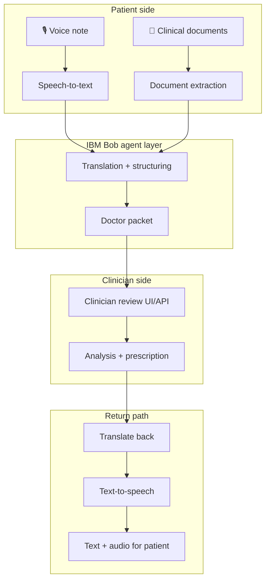

# Architecture

The Healthy Bob is a small, pluggable pipeline. Every stage has a protocol so the hackathon demo can be replaced by production services without changing the orchestration.

## Contracts

| Interface | Module | Mock implementation |
|---|---|---|
| `SpeechToText` | `audio/stt.py` | `SidecarTranscriptSTT` |
| `TextToSpeech` | `audio/tts.py` | `PlaceholderWavTTS` |
| `DocumentExtractor` | `documents/extractor.py` | `LabReportExtractor` |
| `Translator` | `translation/translator.py` | `MockTranslator` |
| `Clinician` | `bob_agent/clinician.py` | `SampleClinician` |

`bob_agent.pipeline.BobBridge` wires these together. `bob_agent.models` defines the immutable data passed between stages.

## Data flow

1. `PatientIntake` carries the audio placeholder, language, and document paths.
2. `Transcript` + `ExtractedDocument`s are localized into the clinician language.
3. `build_doctor_packet()` creates a sourced `DoctorPacket` with an agent prompt.
4. `Clinician.review()` returns a `DoctorAnalysis`.
5. The analysis is translated into the patient's language, synthesized, and returned as `PatientMessage`.

## Going production

- Add authentication, consent capture, and audit events before intake.
- Use real STT/OCR/translation/TTS behind the existing protocols.
- Send `bob_agent/prompts.py` templates to a live IBM Bob agent.
- Store PHI only where policy permits; encrypt in transit and at rest.
- Add human-in-the-loop review for both the doctor packet and the patient reply.
